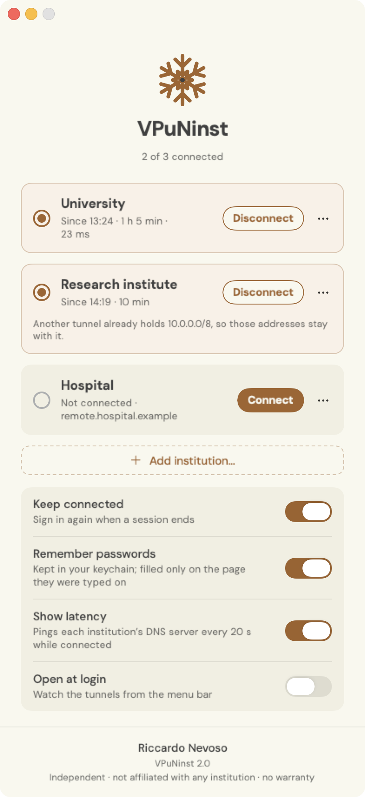

<p align="center">
  
</p>

<p align="center">
  
  
  
  
</p>

A small native macOS app for the VPNs of the institutions you belong to (a
university, a research institute, a hospital), built on
[openconnect](https://www.infradead.org/openconnect/). It signs you in to each
with the institution’s own single sign-on and MFA inside its own window,
starts the tunnels with Touch ID, keeps them up, and runs several side by
side, each answering only for its own addresses and names. It is made for
researchers who work across several institutions and need each one’s
network from the same Mac.

> **An independent project, not affiliated with any institution or VPN
> vendor. It comes with no warranty, and you use it at your own risk.** See the
> [disclaimer](#disclaimer).

<table>
<tr>
<td width="46%"></td>
<td>

### What it does

**Signs in inside the app.** Each institution’s login and MFA run in the
app’s own window. The gateway’s cookie is picked up directly; there’s no
browser step and nothing to copy and paste.

**Several at once.** Each tunnel carries only the ranges its gateway names
and answers only for its own domains, so connecting one never takes over
another’s, or your network’s.

**Remembers your passwords.** Optional, and on by default. Each one is
stored in your macOS keychain on this Mac only, and filled only into the
page it was typed on. MFA stays with you.

**Touch ID, not your password.** Connect and Disconnect ask for Touch ID.
The few steps that need root go through a small helper that can do only
three things without your password. The openconnect it runs is VPuNinst’s own
build, which only root can change; there is nothing else to install.

**Stays connected.** openconnect rides out Wi-Fi changes and sleep. The
app lives in the menu bar (no Dock icon), under a snowflake: full strength
while a tunnel is up, dimmed while none is. When a session ends, the app
signs in again, and while the single sign-on is still valid that skips MFA.

**Leaves your network alone.** It never writes your Wi-Fi’s DNS, which is
what leaves a Mac unable to look anything up after a VPN dies, and it
removes whatever a dead tunnel left behind.

</td>
</tr>
</table>

## The VPNs it speaks

The kind of VPN is in the institution’s instructions, usually as the name of
the app they tell you to install.

| VPN | openconnect protocol | |
|---|---|---|
| Palo Alto Networks, portal or gateway | `gp` | tested; a portal’s gateway on another server untested |
| Cisco | `anyconnect` | untested |
| Fortinet | `fortinet` | untested |
| Juniper | `nc` | untested |
| Ivanti (Pulse) | `pulse` | untested; if it fails, try Juniper with the same server |
| F5 | `f5` | untested |

**Untested** means not yet tried against a real gateway of that kind. If one
fails, `~/Library/Logs/VPuNinst.log` and `/var/log/vpuninst-<id>.log` say
where.

What it can’t do: sign in without a web page (certificates, smart cards, a
plain username and password typed into openconnect, which is all
openconnect offers for Array Networks), pass a gateway’s device check beyond
the HIP report openconnect sends for Palo Alto, or reach a VPN openconnect
doesn’t speak (IPsec, WireGuard, OpenVPN).

## Install

For a Mac on macOS 14 or later, with Apple silicon or Intel. VPuNinst brings
its own openconnect, so there is nothing to install first. On Intel it has so
far been tried only under Rosetta, as far as the sign-in.

1. Download **`VPuNinst-<version>.pkg`** from the
   [latest release](https://github.com/H4lBarAd11/VPuNinst/releases/latest).
2. Open it and follow the installer. It asks for your Mac’s administrator
   password once.

macOS then says it cannot verify the developer, because the package isn’t
signed with a paid Apple certificate. Allow it once for each package you
download:

- **macOS 15 Sequoia and later:** press **Done**, then open **System Settings ▸
  Privacy & Security**, scroll down to the message about the package and press
  **Open Anyway**.
- **macOS 14 Sonoma:** right-click the package ▸ **Open** ▸ **Open**.

The installer puts VPuNinst in Applications and does the
[root setup](#the-root-setup) for the account that runs it: the helper and its
tunnel script, VPuNinst’s openconnect, an empty list of institutions, and the
sudoers rule. Its first page lists them before
anything is installed. On a Mac with several accounts, the rule names only
the account that ran the installer, and an install from another account
replaces it.

To update, download the next version’s package and open it the same way.
The institutions you added stay.

Remove any other app or script that runs openconnect first. One that stops
every openconnect it finds, as simple VPN scripts do, takes VPuNinst’s
tunnels down with it and leaves their settings for VPuNinst to clean up.

## Adding an institution

Press **Add institution…** and give it:

- **Name:** what the window and the menu call it.
- **VPN:** the kind, from the table above.
- **Server:** the address in the institution’s instructions, such as
  `vpn.example.edu`, with a port or a path if they give one.
- **Connects to** (Palo Alto): **Portal** if the instructions call the address
  a portal, **Gateway** if they call it a gateway. Through a portal, VPuNinst
  asks it for its gateways and connects to the best one, signing in to that
  gateway too when the portal hands out no cookie for it; the second sign-in
  goes through the same identity provider and usually ends by itself. A
  gateway on another server than the portal’s is added to the institution the
  first time the portal names it, with your administrator password. **Group**
  (Cisco) and **Realm** (Fortinet), only if the instructions name one.
- **Internal domains**, optional: domains whose names only the institution’s
  own DNS knows. Gateways usually send their own; add any they leave out.

Saving asks for your administrator password: the list of servers root may
connect to is the helper’s, and changing it is kept out of the sudoers rule.
Edit and Remove are in each institution’s **⋯** menu. Removing one also
deletes its saved password and its sign-in cookies.

## Run from source

```sh
git clone https://github.com/H4lBarAd11/VPuNinst.git && cd VPuNinst
sh tools/make-signing-cert.sh   # once: a local certificate to sign the app with
./build.sh install              # → ~/Applications/VPuNinst.app
```

Apple’s developer tools are all it needs. The first build also fetches
openconnect’s and OpenSSL’s sources and builds them, which takes a few
minutes; later builds reuse them until their pinned versions change.

The certificate is self-signed and stays in your login keychain. It gives
every build the same signature, so the keychain’s permission for the saved
passwords survives rebuilds (see below). Without it, `build.sh` signs ad hoc.

Then the root setup, which the package would otherwise do for you. Read
`helper/vpuninst-helper`, `helper/vpuninst-tunnel` and `helper/sudoers.in` first.
They’re short, and they’re what you are letting run as root.

```sh
# 1. the helper and its tunnel script: fixed verbs, owned by root
sudo install -o root -g wheel -m 0755 helper/vpuninst-helper helper/vpuninst-tunnel /Library/PrivilegedHelperTools/

# 2. openconnect, its HIP script and an empty OpenSSL config, owned by root
sudo install -d -o root -g wheel -m 0755 /Library/PrivilegedHelperTools/vpuninst/ssl
sudo install -o root -g wheel -m 0755 build/openconnect/openconnect build/openconnect/hipreport.sh /Library/PrivilegedHelperTools/vpuninst/
sudo install -o root -g wheel -m 0644 /dev/null /Library/PrivilegedHelperTools/vpuninst/ssl/openssl.cnf

# 3. let the app run connect / disconnect / repair without a password
sed "s/@USER@/$USER/" helper/sudoers.in > /tmp/vpuninst.sudoers
sudo visudo -cf /tmp/vpuninst.sudoers && sudo install -o root -g wheel -m 0440 /tmp/vpuninst.sudoers /etc/sudoers.d/vpuninst
```

`git pull` and `./build.sh install` bring the new code. After changing the
helper or the tunnel script, reinstall them with step 1; after a new
openconnect build, repeat step 2. If the openconnect installed isn’t the one
the app was built with, the window says so.
Built this way, the app lives in `~/Applications`, where the package doesn’t
touch it. Keep one copy or the other: two would each watch and repair the
same tunnels.

**Releasing.** Raise `VERSION`, commit and push, then run
`sh packaging/release.sh`. It first checks that openconnect and OpenSSL are
the latest releases (see below) and builds them afresh, never from an earlier
build. It then builds the package on this Mac, signed with the local
certificate so that the keychain’s permission survives an update too, and
publishes it as release `v<VERSION>`. The notes are the message of the commit
that raised `VERSION`, followed by the sources openconnect was built from and
the shipped binary’s checksum. `./build.sh pkg` builds the package alone, into
`build/`. `swift tools/make-assets.swift` redraws the icon and the
installer’s background, `swift tools/make-banner.swift` this banner and the
repository’s social preview (`docs/social.png`, uploaded by hand under
Settings ▸ General), and `tools/make-splash.swift` the launch animation below;
its header has the command.

## The root setup

**What the sudoers rule trades.** macOS can’t show Touch ID for a `sudo` that an
app starts. So the app asks for Touch ID itself, and `sudo` lets the helper
run without a password. That makes Touch ID a check in the app, not a lock
enforced by macOS: any program running as you could call the helper. Three
things limit that:
- the helper can only connect to an institution on its list, or to a portal’s
  gateway on that list, disconnect, and undo what a dead tunnel left behind;
- the list is root’s, and only `add` and `remove` change it, which are left
  out of the rule and take your password. Otherwise a program running as you
  could point root’s openconnect at a server of its own, and that server’s
  routes and DNS would be applied as root;
- nothing it runs as root can be changed by you, or by anything running as
  you: openconnect and its HIP script are installed in
  `/Library/PrivilegedHelperTools/vpuninst/`, which only root can change, and
  the tunnel script is VPuNinst’s own, not the usual vpnc-script;
- nor can what it trusts. openconnect trusts macOS’s own root certificates
  alone, read at each connect from a keychain only the system can change.
  OpenSSL is built unable to load code from disk, and every folder it knows,
  its configuration file’s included, is that same root-only one; the
  configuration file is empty, and the helper names it again.

One limit: macOS restricts a few certificate authorities beyond simply
listing them, for instance trusting an authority’s older certificates but not
its newer ones. Those restrictions are part of how macOS checks a certificate,
not of the certificates themselves, so OpenSSL can’t apply them, and trusts
every authority macOS lists. Checking the gateway through macOS instead would
break Palo Alto portals, which send the connection on to other servers.

Everything the gateway sends (addresses, ranges, DNS servers, domain names)
is checked before it reaches `route`, `ifconfig` or `scutil`, so a gateway
can’t slip a command of its own into them.

Each institution’s tunnel is changed by one call at a time, so a repair never
takes a tunnel that is still coming up for one that died.

## openconnect, and its security fixes

VPuNinst brings its own openconnect, built by `tools/build-openconnect.sh`
from openconnect’s and OpenSSL’s published sources, each pinned by version and
checksum, as one binary for Apple silicon and Intel. It needs nothing but
Apple’s developer tools and runs in an emptied environment. It checks that the
binary links only libraries that come with macOS, names no folder a user
could own, and reports the versions it was built from. OpenSSL follows its
long-term support line, 3.5, which gets security fixes for years. The sources
and the binary’s checksum are in the app, in
`Contents/Resources/Licenses/SOURCES.txt`, and in each release’s notes.

That makes VPuNinst the way their security fixes reach you: when openconnect
or OpenSSL publishes one, a new VPuNinst release carries it, so install new
versions as they come. `tools/check-upstream.sh` says when either has a newer
release, and `packaging/release.sh` won’t publish without the latest.

## Removing it

To undo everything, delete VPuNinst from Applications, then:

```sh
sudo rm -r /etc/sudoers.d/vpuninst /Library/PrivilegedHelperTools/vpuninst-* /Library/PrivilegedHelperTools/vpuninst
sudo pkgutil --forget io.github.h4lbarad11.vpuninst.pkg   # if it came from the package
```

## How it works

```
 app (you, Touch ID)                helper (root, via sudo -n)
 ───────────                        ──────────────────────────────────
 sign-in page → cookie  ─────────►  connect <id> …   cookie on stdin → openconnect --background
 watch: pid files + tunnel state    disconnect <id>  stop that openconnect, undo its settings
 a dead tunnel’s leftovers? ─────►  repair           undo what dead tunnels left behind
                                    openconnect ──►  vpuninst-tunnel: routes, DNS, a record of both
```

| Path | What |
|---|---|
| `Sources/` | SwiftUI app: window, menu-bar item, the sign-in for each VPN, watcher, launch splash |
| `helper/vpuninst-helper` | the root half; takes `connect`, `disconnect`, `repair`, `add`, `remove` and nothing free-form |
| `helper/vpuninst-tunnel` | sets up and takes down one tunnel; openconnect runs it in place of vpnc-script |
| `tools/build-openconnect.sh` | builds VPuNinst’s openconnect and OpenSSL from pinned sources; `tools/check-upstream.sh` says when they have a newer release |
| `helper/sudoers.in` | the sudoers rule: the first three verbs without a password |
| `packaging/` | the installer: its checks and pages, the postinstall that does the root setup, and the release script |
| `tools/` | draw the icon, the installer’s background, this banner, the social preview and the launch animation; make the local signing certificate |

The list of institutions is `/Library/PrivilegedHelperTools/vpuninst-institutions`,
one per line, with the gateways on other servers each portal may send its
tunnel to. Each running tunnel has a pid file and a record of what it set
up in `/var/run/vpuninst/`.

Logs: `~/Library/Logs/VPuNinst.log` for the app (exit codes and errors, never a
cookie or a password) and `/var/log/vpuninst-<id>.log` for each institution’s
openconnect, with the session before it in `/var/log/vpuninst-<id>.log.1`. The
installer’s root setup writes to `/var/log/install.log`.

### Several tunnels at once

Every tunnel sets up only what is its own, and records it, so that taking
one down undoes exactly that:

- **Routes.** The ranges its gateway names go into its own tunnel interface,
  and disappear with it. Where two tunnels’ ranges overlap, each address goes
  to the tunnel with the narrower range, as routing has it, and both
  institutions say so in the window; an identical range stays with the
  tunnel that had it first. No app can give one address to two networks.
- **Ranges kept out of a tunnel** are honoured only inside its own ranges and
  outside every other tunnel’s, so one gateway can’t send another tunnel’s
  traffic out onto your network.
- **The route to the gateway** goes through your network’s router, so the
  tunnel’s own packets don’t travel inside it, and is pointed at the new
  router when the network changes.
- **DNS.** Each tunnel’s DNS servers answer only for its own domains, as a
  resolver added beside your network’s, which keeps answering everything
  else. Its servers are held by routes of their own into its tunnel, so a
  narrower range from another tunnel can’t draw its queries away. A domain
  another tunnel already answers for, or one inside it, stays with that
  tunnel, and a single-label one (`com`, `local`) is never taken. A tunnel
  whose gateway names no domain has its DNS unused until you add the domains
  to the institution; the window says so. A DNS filter that answers every
  query itself needs a rule sending each institution’s domains to its servers.
- **A tunnel that carries everything.** Some institutions send all traffic
  through their tunnel. Such a tunnel also answers every name. Only one of
  them can do that at a time, beside any number of the others.

### The saved passwords

- **Where they live:** one generic item per institution in your login
  keychain, labelled “VPuNinst — *institution* sign-in”. The login keychain stays
  on this Mac and is never synced to iCloud.
- **How they get there:** a password is saved when you submit a login form in
  the sign-in window, from an `https` page (the page itself, not a frame
  inside it), and kept with that page’s host. The scripts that save and fill
  it run apart from the page’s own, which can’t reach them.
- **How they’re used:** a password is filled into the login form only on that
  same host, as a browser ties a password to a site, and passed to the page
  as a JSON-encoded value, so no character in it can break out of the fill
  script. The fill script checks the page’s address again itself before
  touching the form. A rule by domain would not be safe for everyone: the last
  two parts of `idp.example.ac.uk` are `ac.uk`.
- **Logins split over two pages** (a username first, then a password, as
  some large identity providers do) may not be saved or filled; you type the
  password, and nothing else changes.
- **No loops:** the form is submitted automatically once per sign-in. If it
  comes back (a changed password), it is filled but left for you to submit.
- **After an update:** the first time a build signed differently from the
  last reads an item, macOS asks whether VPuNinst may use it, and wants
  your Mac login password (the dialog doesn’t offer Touch ID). Choose
  **Always Allow**. Every package is signed with the same certificate, and so
  is every build from source once you have made your own with
  `tools/make-signing-cert.sh`, so that is once; signed ad hoc, it is after
  every rebuild. Switching between the package and your own builds counts as
  a change of signature. The app keeps working while the dialog
  waits, so you can also type the password into the page yourself.
- **Removing them:** turning off **Remember passwords** deletes them all;
  removing an institution deletes its own. You can also delete them in
  Keychain Access.

### How the app knows the setup is done

The app is ready when the helper exists, is owned by root, and `sudo -n -l`
shows the helper’s `connect`, `disconnect` and `repair` on a `NOPASSWD` line.
A rule that also lets `add` or `remove` run without a password counts as not
set up, because anything running as you could then add a server of its own. Otherwise the
window shows a setup card pointing here.

## Design

Set in [DM Sans](https://fonts.google.com/specimen/DM+Sans) (SIL OFL, included)
on ivory `#F9F8EF` with ink `#404040`. Caramel `#9A6636` marks the tunnels and
their actions, and nothing else.


The mark is a six-armed snowflake, caramel with an ink centre. At launch it
blooms open where the window is about to appear, its arms growing out in
turn, VPN is written in beneath it, and the window opens out of the flake.
With Reduce Motion on, the flake and lettering just fade in and out.

In the menu bar the flake keeps its spines and outer chevrons only, which is
what still reads at 18 points: full strength while a tunnel is up, dimmed
while none is. The installer carries it faintly in its corner.

<br clear="right">

## Disclaimer

VPuNinst exists to help researchers who work across several institutions
reach each one’s network from the same Mac, without a different VPN app for
each.

It is an independent, personal project. It is not affiliated with, endorsed
by or supported by any university, research institute, hospital or other
institution, nor by any VPN vendor, and their IT services can’t help with
it. It connects to their VPNs with your own accounts, through the same
gateways their own apps use. Institution and vendor names appear only to say
which VPNs it can connect to, and belong to their owners.

It is provided as is, without warranty of any kind. To the fullest extent the
law allows, the author accepts no responsibility for anything that happens
through its use: to your Mac, your data, your network or Wi-Fi, an
institution’s network, systems or accounts, or anything else, whether it
comes from the app, from openconnect, or from the way either is used.

Use it only with accounts and VPNs you are authorised to use, and according to
each institution’s IT and security policies. Some institutions don’t allow
their network to be used alongside another; where they don’t, their rule
applies.

The installer shows this disclaimer and asks you to agree to it before it
installs anything.

## Licence

Copyright © 2026 Riccardo Nevoso. VPuNinst is free software under the
[GNU General Public License](LICENSE), version 3 or any later version. You may
use, study, share and change it; anything you distribute that is built from it
must come with its source, under the same licence. It comes with no warranty
(see the [disclaimer](#disclaimer)).

DM Sans is under the SIL Open Font License (`Resources/fonts/DM-Sans-OFL.txt`).
VPuNinst includes openconnect, under the GNU Lesser General Public License
2.1, and OpenSSL, under the Apache License 2.0, both built unmodified from
their published sources. Their licences, and the exact sources each release
was built from, are inside the app, in `Contents/Resources/Licenses`.

<p align="center"><sub>Made by <b>Riccardo Nevoso</b></sub></p>
